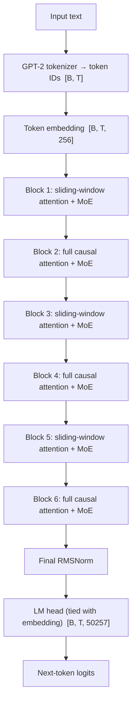
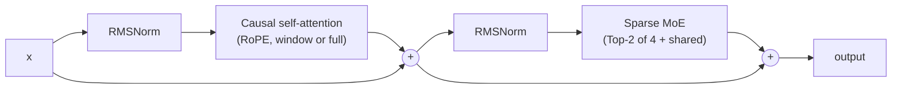
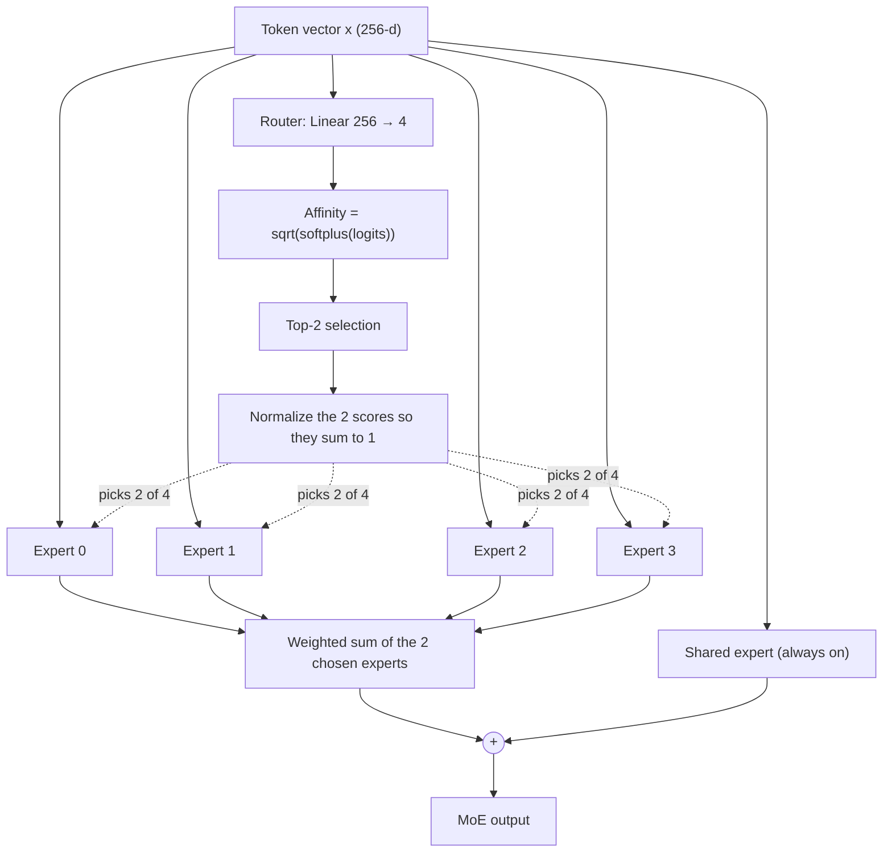

# Mini DeepSeek-MoE: a Mixture-of-Experts language model trained from scratch on a free T4 GPU

This project builds a small, **DeepSeek-inspired Mixture-of-Experts (MoE)** language model in plain
PyTorch. It trains the model **from randomly initialized weights** on the
[TinyStories](https://huggingface.co/datasets/roneneldan/TinyStories) dataset, on a single Google Colab
**T4 GPU (16 GB)**.

The goal is educational: implement the main building blocks of a modern LLM by hand (RoPE, RMSNorm,
SwiGLU, sliding-window attention, sparse expert routing with a shared expert, and load balancing).
Then train the model end to end, generate text with it, and look at how the router sends tokens to experts.

> **Note:** this is a small model *inspired by* DeepSeek's MoE design. It is **not** a reproduction of
> DeepSeek-V3/V4. The GPT-2 tokenizer is used only to turn text into token IDs. **No GPT-2 weights are
> loaded.**

---

## Table of contents

1. [What I built](#what-i-built)
2. [Project structure](#project-structure)
3. [Model architecture](#model-architecture)
4. [Mixture of Experts (MoE) in detail](#mixture-of-experts-moe-in-detail)
5. [Training pipeline](#training-pipeline)
6. [Fitting into a 16 GB T4](#fitting-into-a-16-gb-t4)
7. [Text generation](#text-generation)
8. [Inspecting the router](#inspecting-the-router)
9. [How to run (Google Colab)](#how-to-run-google-colab)
10. [Results](#results)
11. [What this project does not implement](#what-this-project-does-not-implement)
12. [References](#references)

---

## What I built

- A **decoder-only Transformer language model** written from scratch in PyTorch (`model.py`).
- A **sparse Mixture-of-Experts feed-forward layer** in every Transformer block. Each layer has 4
  routed experts, the router picks the Top-2 for each token, and 1 shared expert is always on.
- **Hybrid attention:** layers alternate between **sliding-window attention** (each token sees only the
  last 64 tokens) and **full causal attention**.
- **Modern LLM components:** RMSNorm (pre-norm), Rotary Position Embeddings (RoPE), SwiGLU activations,
  and tied input/output embeddings.
- An **auxiliary load-balancing loss** that keeps the router from sending every token to the same expert.
- A **memory-efficient training script** (`train.py`) for a 16 GB GPU, using FP16 mixed precision,
  gradient scaling, gradient checkpointing, gradient accumulation, and gradient clipping.
- A **text generation script** (`generate.py`) with temperature and top-k sampling.
- A **router inspection tool** (`inspect_router.py`) that prints which experts each token was sent to
  in every layer.
- A **Colab notebook** (`Mini_DeepSeek_MoE_T4.ipynb`) that runs the full workflow.

---

## Project structure

```
mini_deepseek_moe_t4/
├── model.py                     # The model: RMSNorm, RoPE, attention, SwiGLU experts, SparseMoE, Transformer
├── train.py                     # Data loading, tokenization, training loop, evaluation, checkpointing
├── generate.py                  # Load a checkpoint and generate text (temperature + top-k sampling)
├── inspect_router.py            # Print Top-K expert choices per token, per layer
├── Mini_DeepSeek_MoE_T4.ipynb   # Colab notebook: install → smoke test → train → generate → inspect
├── requirements.txt             # torch, transformers, datasets, numpy, tqdm
└── README.md
```

---

## Model architecture

### Configuration

| Setting | Value |
|---|---|
| Model type | Decoder-only Transformer with sparse MoE FFN layers |
| Vocabulary | 50,257 (GPT-2 BPE tokenizer) |
| Hidden size (`d_model`) | 256 |
| Transformer layers | 6 |
| Attention heads | 8 (head dim = 32) |
| Expert FFN hidden size (`d_ff`) | 512 |
| Routed experts per layer | 4 |
| Experts active per token (Top-K) | 2 |
| Shared experts per layer | 1 (always active) |
| Context length | 256 tokens |
| Sliding window (even layers) | 64 tokens |
| Position encoding | RoPE (base 10,000) |
| Normalization | RMSNorm, pre-norm |
| Embeddings | Input embedding and LM head share weights |
| Dropout | 0.0 |

### Parameter count

| Component | Parameters |
|---|---|
| Token embedding (shared with LM head) | 12,865,792 |
| Attention per layer (QKV + output projection) | 262,144 |
| One SwiGLU expert | 393,216 |
| One full layer (attention + router + 5 experts + 2 norms) | 2,229,760 |
| **Total (6 layers)** | **~26.2M** |
| **Active per token** (2 routed + 1 shared expert) | **~21.5M** |

Almost half of the parameters are in the embedding table, because the GPT-2 vocabulary is large compared
with `d_model = 256`. Of the 6 × 5 = 30 experts, only 6 × 3 = 18 run for any given token.

### Overall flow



### Inside one Transformer block

Each block uses the **pre-norm residual** design (`TransformerBlock` in `model.py`):

```
x = x + Attention(RMSNorm(x))
x = x + MoE(RMSNorm(x))          # MoE also returns an auxiliary balancing loss
```



### Components

**RMSNorm** (`RMSNorm`): normalizes each vector by its root-mean-square and multiplies it by a learned
scale. Unlike LayerNorm it does not subtract the mean and has no bias. The calculation runs in FP32 for
stability, even when the model runs in FP16.

**Rotary Position Embeddings** (`apply_rope`): attention by itself does not know word order. RoPE rotates
each pair of dimensions in the query and key vectors by an angle that depends on the token's position.
The dot product between a query and a key then depends on how far apart the two tokens are. Nothing is
learned and no position embedding table is needed.

**Causal self-attention** (`CausalSelfAttention`):
- One linear layer produces Q, K and V. These are split into 8 heads of size 32.
- RoPE is applied to Q and K.
- Attention uses PyTorch's fused `F.scaled_dot_product_attention`, which runs FlashAttention or
  memory-efficient kernels when they are available.
- **Hybrid attention pattern:**
  - **Even layers (1, 3, 5): sliding-window attention.** Each token sees only itself and the previous
    63 tokens. The model builds a boolean mask: `k_pos <= q_pos and k_pos >= q_pos - 63`.
  - **Odd layers (2, 4, 6): full causal attention.** Each token sees every earlier token
    (`is_causal=True`).
  - Local layers are cheap and focus on nearby context. Global layers keep long-range information
    flowing. Long-context models use the same mix of local and global layers.

**SwiGLU expert** (`SwiGLUExpert`): every expert, including the shared one, is a gated feed-forward
network:

```
Expert(x) = W_down( SiLU(W_gate x) ⊙ W_up x )      # 256 → 512 → 256
```

**Weight tying and initialization:** the output layer (`lm_head`) reuses the token embedding matrix,
which saves 12.9M parameters. All linear and embedding weights start from `N(0, 0.02)`.

---

## Mixture of Experts (MoE) in detail

This is the main idea of the project, implemented in `SparseMoE` in `model.py`.

### Why MoE?

A normal Transformer runs the **same** feed-forward network for every token. An MoE layer contains
**several** feed-forward networks ("experts"), and a small **router** chooses which ones each token uses.
The model can therefore hold more parameters (more capacity) while each token only pays the compute cost
of a few experts. DeepSeek, Mixtral and Switch Transformer are all built on this idea.

### DeepSeek-style design: routed experts plus a shared expert



Step by step, for each token:

1. **Router scores.** A linear layer (`256 → 4`, no bias) gives one logit per expert.
2. **Affinity function.** The logits are turned into affinity scores with
   `sqrt(softplus(logits))`. This is a simplified version of the affinity function in recent DeepSeek
   models, used in place of a plain softmax. All scores are positive and grow smoothly.
3. **Top-K selection.** The 2 experts with the highest affinity are chosen.
4. **Gate weights.** The 2 chosen scores are divided by their sum, so the gate weights add up to 1.
5. **Expert computation.** Tokens are grouped by expert. Each expert runs **only on the tokens sent to
   it** (`torch.where` + `index_select`). The weighted outputs are added back into place with
   `index_add`. Experts that receive no tokens are skipped, so the computation really is sparse.
6. **Shared expert.** One extra SwiGLU expert processes **every** token, and its output is added to the
   routed output. The shared expert learns knowledge every token needs (basic grammar, common patterns),
   which frees the routed experts to specialize. This idea comes from **DeepSeekMoE**.

```
MoE(x) = Σ_{i ∈ Top2(x)} g_i(x) · Expert_i(x)  +  SharedExpert(x)
```

### Load-balancing loss

Without some pressure to balance, a router tends to **collapse**: it sends almost every token to one or
two experts and the other experts never learn. To prevent this, every MoE layer returns a
**Switch-Transformer-style auxiliary loss**:

```
f_i = fraction of Top-K slots assigned to expert i
P_i = mean router softmax probability for expert i
aux_loss = num_experts × Σ_i  f_i · P_i
```

The loss is smallest when tokens and router probability are spread evenly across the experts. The
6 layers' aux losses are averaged, and the training loss becomes:

```
loss = cross_entropy(next_token) + 0.01 × aux_loss
```

With perfectly even routing, `aux_loss ≈ 1.0`. Watch the `aux` value in the training logs: if it stays
close to 1, the experts are being used evenly.

### Router bookkeeping for inspection

After each forward pass, every MoE layer stores `last_indices` (which experts each token was sent to) and
`last_weights` (the gate weights). `inspect_router.py` reads these values.

---

## Training pipeline

All of this is in `train.py`.

### 1. Data

- Dataset: **TinyStories** (`roneneldan/TinyStories`), short simple English stories written by
  GPT-3.5/4. Its narrow vocabulary and style make it possible to train a tiny model to write coherent
  text.
- Default: the first **100,000 stories**.
- Each story is tokenized with the **GPT-2 BPE tokenizer** (max 512 tokens per story). An end-of-text
  token is added after each story.
- All stories are joined into **one long token stream**, stored as `int32` (half the RAM of `int64`).
- Split: **95% train / 5% validation**.

### 2. Batching

`get_batch` picks random start positions in the token stream and cuts out windows of `seq_len + 1`
tokens:
- `x` = tokens `[i, i+seq_len)` (the input)
- `y` = tokens `[i+1, i+seq_len+1)` (the same window shifted by one: the next token to predict)

The tokens are converted to `int64` only after they are moved to the GPU.

### 3. Training loop

| Setting | Value |
|---|---|
| Optimizer | AdamW (β1 = 0.9, β2 = 0.95, weight decay = 0.1) |
| Learning rate | 3e-4, constant |
| Micro-batch | 4 sequences × 256 tokens |
| Gradient accumulation | 4 steps → **effective batch of 16 sequences (4,096 tokens)** |
| Optimizer steps | 2,000 (≈ 8.2M tokens seen) |
| Precision | FP16 autocast + `GradScaler` |
| Gradient clipping | max norm 1.0 |
| Loss | Cross-entropy (computed in FP32) + 0.01 × aux loss |
| Seed | 42 |

Each optimizer step:
1. Run 4 micro-batches. For each one: forward pass under FP16 autocast, compute the loss, divide it by 4,
   and call `scaler.scale(loss).backward()`.
2. Unscale the gradients, clip them to norm 1.0, call `scaler.step(optimizer)`, update the scaler, and
   zero the gradients.
3. Every 25 steps, log `lm_loss`, `aux`, and `lr`.
4. Every `eval_interval` steps (default 250), average the loss over 20 train batches and 20 validation
   batches, print the validation **perplexity**, and save a checkpoint.

### 4. Checkpoints

Checkpoints are saved to Google Drive (`/content/drive/MyDrive/mini_deepseek_checkpoints/mini_deepseek_moe_t4.pt`)
so they survive Colab disconnects. Each checkpoint contains:
- model, optimizer and grad-scaler state
- the model `config` dictionary, so the generation and inspection scripts can rebuild the same model
- the step number, the validation loss, and the tokenizer name

---

## Fitting into a 16 GB T4

| Technique | What it does |
|---|---|
| **FP16 mixed precision** | Activations and matmuls run in half precision. The T4 has Tensor Cores for FP16 but **no bfloat16 support**, so FP16 is used. |
| **Dynamic loss scaling** (`GradScaler`) | Prevents small FP16 gradients from underflowing to zero. |
| **FP32 where it matters** | RMSNorm, RoPE, router softmax/affinity, and the cross-entropy loss run in FP32 for numerical stability. |
| **Gradient checkpointing** | Activations inside each Transformer block are not stored. They are recomputed during the backward pass, trading extra compute for much less memory. It can be turned off with `--no_gradient_checkpointing`. |
| **Gradient accumulation** | Allows an effective batch of 16 with only 4 sequences in memory at a time. |
| **Fused attention** | `scaled_dot_product_attention` avoids creating the full attention matrix when an efficient kernel is available. |
| **int32 token storage** | Halves the host RAM used by the token stream. |

---

## Text generation

`generate.py` loads a checkpoint and generates text **autoregressively**:

1. Encode the prompt.
2. Run the model on the last 256 tokens at most (the context window).
3. Take the logits for the last position and apply **temperature** (default 0.8) and **top-k
   filtering** (default 40).
4. Sample the next token, append it, and repeat until `max_new_tokens` is reached or the model produces
   the end-of-text token.

---

## Inspecting the router

`inspect_router.py` sends one sentence through the trained model and prints, for **every layer and every
token**, the 2 experts the router chose and their gate weights. The output looks like this (the numbers
below are only an example):

```
Transformer layer 1
            Once -> Expert 2: 0.534, Expert 0: 0.466
           Ġupon -> Expert 1: 0.512, Expert 3: 0.488
...
```

(`Ġ` is how the GPT-2 tokenizer marks a leading space.) Use this to check whether experts specialize, for
example in punctuation, names, or verbs, and whether routing patterns differ between layers.

---

## How to run (Google Colab)

You can also open `Mini_DeepSeek_MoE_T4.ipynb` in Colab and run the cells in order.

1. **Runtime → Change runtime type → T4 GPU**, then check the GPU:
   ```python
   !nvidia-smi
   ```
2. Upload or extract the project to `/content/mini_deepseek_moe_t4` and install the dependencies:
   ```python
   %cd /content/mini_deepseek_moe_t4
   !pip install -r requirements.txt
   ```
3. Mount Google Drive so checkpoints are kept:
   ```python
   from google.colab import drive
   drive.mount('/content/drive')
   ```
4. **Smoke test** (a few minutes):
   ```python
   !python train.py --num_stories 10000 --max_steps 50 --eval_interval 25
   ```
5. **Full training run:**
   ```python
   !python train.py --num_stories 100000 --max_steps 2000 --batch_size 4 --grad_accum 4 --seq_len 256
   ```
6. **Generate text:**
   ```python
   !python generate.py --prompt "Once upon a time" --max_new_tokens 100
   ```
7. **Inspect routing:**
   ```python
   !python inspect_router.py --text "I am learning machine learning and Python."
   ```

### Command-line options (`train.py`)

| Flag | Default | Meaning |
|---|---|---|
| `--num_stories` | 100000 | Number of TinyStories examples to load |
| `--max_steps` | 2000 | Optimizer steps |
| `--batch_size` | 4 | Micro-batch size |
| `--grad_accum` | 4 | Gradient accumulation steps |
| `--seq_len` | 256 | Context length |
| `--learning_rate` | 3e-4 | AdamW learning rate |
| `--eval_interval` | 250 | Evaluate and save every N steps |
| `--save_interval` | 500 | Save (without evaluating) every N steps |
| `--save_dir` | `/content/drive/MyDrive/mini_deepseek_checkpoints` | Checkpoint folder |
| `--no_gradient_checkpointing` | off | Turn off gradient checkpointing (faster, uses more memory) |

### If you run out of CUDA memory

Reduce the micro-batch size first and raise accumulation, which keeps the effective batch at 16:

```python
!python train.py --num_stories 50000 --max_steps 1000 --batch_size 2 --grad_accum 8 --seq_len 256
```

If that is still not enough, shorten the context:

```python
!python train.py --num_stories 50000 --max_steps 1000 --batch_size 2 --grad_accum 8 --seq_len 128
```

---

## Results

<!-- Fill this in from your own training logs. -->

| Step | Train loss | Val loss | Val perplexity |
|---|---|---|---|
| 250 | – | – | – |
| 1000 | – | – | – |
| 2000 | – | – | – |

**Sample generation** (prompt: *"Once upon a time"*):

```
(paste generated text here)
```

**Router observations:**

- (e.g. how evenly tokens spread across experts; whether any expert seems to specialize)

---

## What this project does not implement

To be clear about scope, the following parts of the real DeepSeek-V3/V4 systems are **not** implemented:

- Multi-head Latent Attention (MLA) and KV-cache compression
- The exact DeepSeek-V4 attention variants (CSA/HCA), Lightning Indexer, and mHC
- Multi-Token Prediction (MTP)
- Auxiliary-loss-free load balancing with per-expert bias terms (this project uses a Switch-style aux loss)
- Fine-grained expert segmentation at large scale (hundreds of experts), and expert-parallel distributed training
- A KV cache for generation: each new token reprocesses the whole context window, which is fine at this size
- Learning-rate warmup or decay (the learning rate is constant)

---

## References

- DeepSeek-AI, *DeepSeekMoE: Towards Ultimate Expert Specialization in Mixture-of-Experts Language Models* (2024)
- DeepSeek-AI, *DeepSeek-V3 Technical Report* (2024)
- Fedus et al., *Switch Transformers: Scaling to Trillion Parameter Models with Simple and Efficient Sparsity* (2021)
- Su et al., *RoFormer: Enhanced Transformer with Rotary Position Embedding* (2021)
- Shazeer, *GLU Variants Improve Transformer* (2020)
- Zhang & Sennrich, *Root Mean Square Layer Normalization* (2019)
- Eldan & Li, *TinyStories: How Small Can Language Models Be and Still Speak Coherent English?* (2023)
